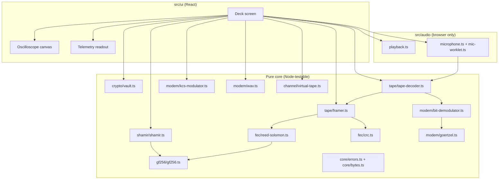
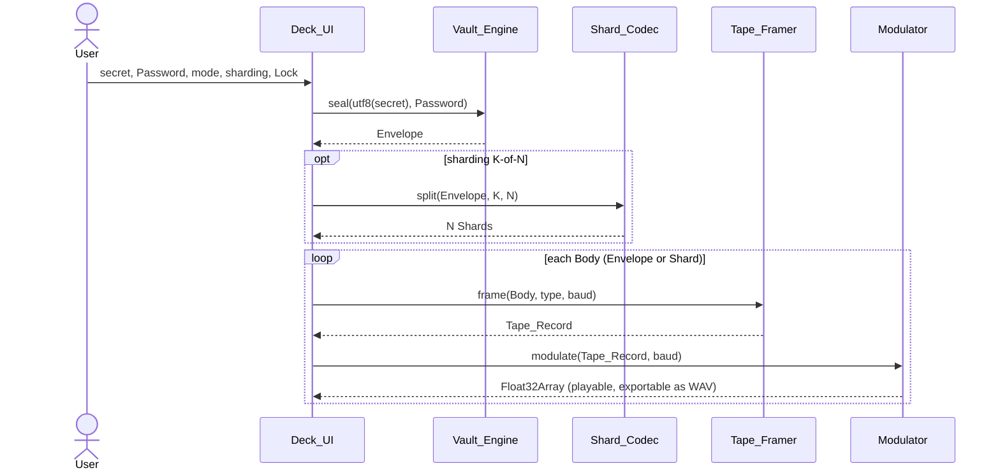
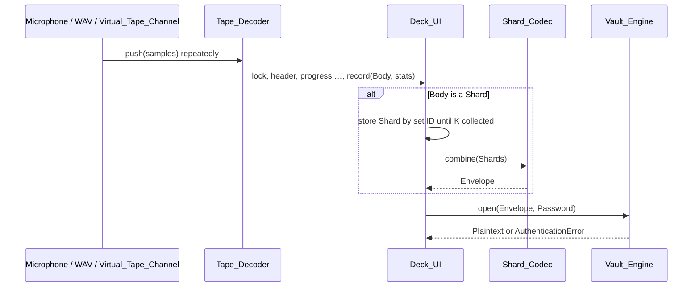
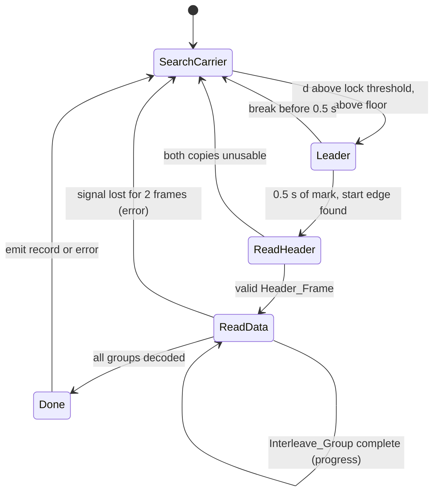

# Design Document

## Overview

BaudVault turns a password-protected secret into Kansas City Standard (KCS) cassette audio and back again, entirely inside the browser. The pipeline has five stages. Each stage is a pure TypeScript module with no DOM dependency, so every stage can be tested in Node with Vitest and fast-check.

```
Plaintext → Vault_Engine → Envelope → [Shard_Codec] → Body → Tape_Framer → Tape_Record → Modulator → PCM / WAV
PCM / WAV / microphone → [Virtual_Tape_Channel] → Tape_Decoder → Body → [Shard_Codec] → Envelope → Vault_Engine → Plaintext
```

This document fixes every byte layout, constant, and algorithm that the requirements refer to. Engine tickets BV-04 to BV-07 implement against these definitions and must not change them without updating this document.

### Design decisions

- **Pure core, thin shell.** Everything under `src/core`, `src/crypto`, `src/gf256`, `src/shamir`, `src/fec`, `src/tape`, `src/modem`, and `src/channel` is pure TypeScript operating on `Uint8Array` and `Float32Array`. Only `src/audio` (Web Audio and microphone) and `src/ui` (React) touch browser APIs other than Web Crypto and `CompressionStream`, both of which Node 24 also provides.
- **Encrypt, then split, then protect.** Shamir sharding runs on the Envelope (ciphertext), not on the Plaintext. One Shard reveals nothing about the Envelope, and K Shards still require the Password.
- **One field for everything.** Shamir and Reed-Solomon share one GF(256) implementation with primitive polynomial 0x11D, in which α = 0x02 generates the multiplicative group.
- **Iteration count is stored in the Envelope.** Production sealing always uses 600,000 PBKDF2 iterations (decision D2). Storing the count lets the property tests run at 1,000 iterations, which keeps BV-09 inside its 15-second budget (one 600,000-iteration derivation measured 310 to 330 ms in Node 24 on the development machine, and P1 and P2 need about 400 derivations). Stored counts also let a future version raise the default without breaking old tapes.
- **Byte count over byte accuracy.** Reed-Solomon can repair wrong bytes but not missing or extra bytes. The demodulator therefore keeps emitting exactly one byte per frame period even when it cannot find a start bit ("flywheel"), turning sync slips into substitutions that Reed-Solomon can fix.
- **Interleaving for knocks.** A desk tap lasts roughly 100 ms, which is about 22 bytes at 2,400 baud and more than one Codeword can correct. Turbo_Mode interleaves 4 Codewords so a burst of up to 64 bytes is spread across 4 blocks.
- **Header sent twice.** The Header_Frame tells the decoder how long the record is, so it is sent twice back to back, each copy with its own 32 parity bytes.
- **Deterministic channel simulation.** The Virtual_Tape_Channel is a pure function over `Float32Array` with a seeded PRNG, so the same seed reproduces the same damage in tests and in the UI. Web Audio only plays the processed buffer.

## Architecture



### Project layout

```
src/
  core/        errors.ts (error classes), bytes.ts (big-endian helpers, concat, zeroize)
  crypto/      vault.ts (seal/open), compress.ts (Deflate with output cap)
  gf256/       gf256.ts (exp/log tables, add, mul, div, inverse, poly eval)
  shamir/      shamir.ts (split/combine, Shard encode/parse)
  fec/         reed-solomon.ts, crc.ts (CRC-32, CRC-16/CCITT-FALSE)
  tape/        framer.ts (Header_Frame, interleave, frame/unframe), tape-decoder.ts (streaming)
  modem/       kcs-modulator.ts, goertzel.ts, bit-demodulator.ts, wav.ts, biquad.ts (shared with channel)
  channel/     virtual-tape.ts, prng.ts
  audio/       playback.ts, microphone.ts, mic-worklet.ts
  ui/          React components and hooks
  properties/  p1-…p5-*.property.test.ts (BV-09)
scripts/       airgap-scan.mjs (source and build scan), airgap-hook.mjs (PreToolUse hook)
test/          no-network.setup.ts (Vitest network stubs), airgap-scan.test.ts (scanner tests)
public/        _headers (Netlify CSP headers, copied into dist/ by Vite)
netlify.toml   build command and publish directory
```

`scripts/`, `test/`, `public/_headers`, and `netlify.toml` sit outside `src/`, so the source rule in Air-Gap Enforcement does not apply to them. The scanner, hook script, and network stubs need this because they name the forbidden identifiers.

Unit tests sit next to the module they test as `*.test.ts`. Imports flow downward only: `ui → audio → tape → (modem, fec) → gf256 → core`. Nothing in the pure core imports from `audio` or `ui`. `channel` sits beside `tape` and may import `modem`; `modem` never imports `channel`, which is why the biquad lives in `modem/`.

## Components and Interfaces

### Errors (`src/core/errors.ts`)

All thrown errors extend `BaudVaultError`, which carries a stable `code` string for the UI.

| Class | `code` | Thrown when |
|---|---|---|
| `InputError` | `INPUT` | The caller passed invalid arguments (sizes, empty password, K/N out of range) |
| `FormatError` | `FORMAT` | Bytes or files do not match a defined layout, or decompressed output exceeds the cap |
| `AuthenticationError` | `AUTH` | AES-GCM rejected the Envelope (wrong Password or tampering) |
| `ShardError` | `SHARD` | Shards are too few, mismatched, or duplicated |
| `UncorrectableError` | `UNCORRECTABLE` | A Codeword has more than 16 byte errors; carries `blocks: number[]` |
| `IntegrityError` | `INTEGRITY` | The restored Body fails its CRC-32 |

Error messages never include Plaintext, Password, or key material.

### Vault_Engine (`src/crypto/vault.ts`)

```ts
export const PBKDF2_ITERATIONS = 600_000
export const MAX_PLAINTEXT_BYTES = 15_360
export const MIN_ITERATIONS = 1_000
export const MAX_ITERATIONS = 5_000_000

/** `options.iterations` exists for tests only; the UI never passes it. */
export function seal(
  plaintext: Uint8Array,
  password: string,
  options?: { iterations?: number },
): Promise<Uint8Array> // Envelope

export function open(envelope: Uint8Array, password: string): Promise<Uint8Array> // Plaintext
```

Seal steps:
1. Validate: `1 ≤ plaintext.length ≤ 15,360`, `password.length > 0`, the Password contains no U+0000, iterations within `[1,000, 5,000,000]`; otherwise `InputError`.
2. Compress with `new CompressionStream('deflate')` (zlib format, RFC 1950).
3. Encode the password as UTF-8 of `password.normalize('NFC')`.
4. Draw a 16-byte salt and 12-byte IV from `crypto.getRandomValues`.
5. Derive the key: `PBKDF2`, hash `SHA-256`, the chosen iterations, output `AES-GCM` 256-bit, non-extractable, usage `encrypt`/`decrypt`.
6. Build the 33-byte header (version, iterations, salt, IV), then encrypt the compressed bytes with `AES-GCM`, `tagLength: 128`, `additionalData` = the 33-byte header.
7. Return `header ‖ ciphertext ‖ tag`.

Open steps:
1. If `envelope.length < 50`, version ≠ 1, or iterations outside `[1,000, 5,000,000]`, throw `FormatError` before deriving any key.
2. If the Password contains U+0000, throw `InputError` before deriving any key. This check runs after step 1, so a malformed Envelope always gets `FormatError` whatever Password the caller passes (Requirement 1.4).
3. Derive the key as in seal and decrypt. Any `OperationError` from Web Crypto becomes `AuthenticationError`.
4. Decompress with `DecompressionStream('deflate')`, reading chunk by chunk. If the running total exceeds 15,360 bytes, cancel the stream and throw `FormatError`. A malformed Deflate stream also becomes `FormatError`.

**Why U+0000 is rejected.** PBKDF2 uses the Password bytes as an HMAC key, and HMAC zero-pads any key shorter than 64 bytes. So `"a"` and `"a\u0000"` derive the same AES key, and a Password that differs only by trailing U+0000 characters would open the Envelope. Rejecting U+0000 in both `seal` and `open` makes every accepted Password map to a distinct key input. No real Password typed on a keyboard contains U+0000.

### GF(256) (`src/gf256/gf256.ts`)

- Primitive polynomial 0x11D (x⁸ + x⁴ + x³ + x² + 1), generator α = 0x02.
- `EXP` table of 512 entries (doubled to avoid a modulo in `mul`) and `LOG` table of 256 entries, built once at module load.
- Exports: `add` (XOR), `mul`, `div`, `inv`, `pow`, `polyEval(coeffs, x)` with coefficients highest degree first.
- `div` and `inv` throw `RangeError` on division by zero; that indicates a programming error, not user input.

### Shard_Codec (`src/shamir/shamir.ts`)

```ts
export const MAX_SHARDS = 16
export function split(envelope: Uint8Array, k: number, n: number): Uint8Array[] // encoded Shards
export function combine(shards: readonly Uint8Array[]): Uint8Array // Envelope
```

- For each Envelope byte `s`, pick a random polynomial `f(x) = s + a₁x + … + a_{K−1}x^{K−1}` over GF(256) with coefficients from `crypto.getRandomValues`. Shard `i` (1 ≤ i ≤ N) stores `f(i)` for every byte.
- `combine` validates in three stages, in this order, and stops at the first failure:
  1. **Layout.** Each Shard is parsed against the v1 layout (version 1, 2 ≤ K ≤ N ≤ 16, 1 ≤ x ≤ N, m ≥ 1). Any Shard that fails throws `FormatError` before any combining (Requirement 2.6).
  2. **Set consistency.** Shards that differ in set ID, K, N, or length, or two Shards with the same index, throw `ShardError` (Requirement 2.4).
  3. **Count.** Only a valid, consistent set with fewer than K Shards throws the `ShardError` that states how many more Shards are needed (Requirement 2.3).
- After validation, `combine` takes the first K Shards in index order and evaluates the Lagrange interpolation at x = 0 for every byte position.
- `split` throws `InputError` when K < 2, N < K, or N > 16 (Requirement 2.5).
- Shards beyond K are accepted and ignored. Mixing Shards from different splits is caught by the set ID; if a set ID collides (1 in 2³²), AES-GCM still rejects the result.

### FEC_Codec (`src/fec/reed-solomon.ts`)

```ts
export const PARITY_BYTES = 32
export const MAX_DATA_BYTES = 223
export function rsEncode(data: Uint8Array): Uint8Array // data.length ≤ 223; returns data ‖ 32 parity
export function rsDecode(codeword: Uint8Array): { data: Uint8Array; corrected: number } // throws UncorrectableError
```

- Generator polynomial `g(x) = ∏_{i=0}^{31} (x − α^i)` (first consecutive root α⁰).
- Systematic encoding: parity is the remainder of `data(x) · x³²` divided by `g(x)`. Byte 0 of the codeword is the highest-degree coefficient.
- Codewords shorter than 255 bytes are shortened codes (implicit leading zeros). The Header_Frame uses this with 16 data bytes, giving 48 bytes.
- Decoding: compute 32 syndromes; if all are zero, return with `corrected: 0`. Otherwise run Berlekamp-Massey for the error locator Λ(x), find roots with a Chien search, and compute magnitudes with the Forney algorithm. Reject as uncorrectable if the degree of Λ exceeds 16, the number of roots found differs from the degree of Λ, or any error position falls outside the (possibly shortened) codeword.
- `UncorrectableError.blocks` is filled in by the framer, which knows the block index.

### CRC (`src/fec/crc.ts`)

- `crc32(bytes)`: IEEE 802.3 / zlib variant (reflected polynomial 0xEDB88320, init 0xFFFFFFFF, final XOR 0xFFFFFFFF). Check value for ASCII `123456789` is 0xCBF43926.
- `crc16(bytes)`: CRC-16/CCITT-FALSE (polynomial 0x1021, init 0xFFFF, no reflection, no final XOR). Check value 0x29B1.

### Tape_Framer (`src/tape/framer.ts`)

```ts
export type BaudRate = 300 | 2400
export type RecordType = 'envelope' | 'shard'
export const MAX_BODY_BYTES = 16_384
export function frame(body: Uint8Array, type: RecordType, baud: BaudRate): Uint8Array // Tape_Record bytes
export function parseHeaderFrame(frame48: Uint8Array, baud: BaudRate): TapeHeader | null // null = unusable copy
export function unframe(record: Uint8Array, baud: BaudRate): { body: Uint8Array; header: TapeHeader; stats: DecodeStats }
```

The byte layouts are in the Data Models section. `unframe` is the batch form used by tests and the Tape Librarian; `TapeDecoder` uses the same functions incrementally.

### Modulator (`src/modem/kcs-modulator.ts`)

```ts
export const SAMPLE_RATE = 44_100
export const AMPLITUDE = 0.7
export function modulate(record: Uint8Array, baud: BaudRate): Float32Array
```

- The bit stream is: leader mark bits, then each record byte as an 11-bit UART frame, back to back with no idle bits, then trailer mark bits.
- Bit `k` of the stream occupies samples `[round(k · 44,100 / baud), round((k + 1) · 44,100 / baud))`. Boundaries are computed from `k` each time, never by adding a rounded per-bit length, so 2,400 baud (18.375 samples per bit) does not drift.
- A single phase accumulator in float64 advances by `2π · f / 44,100` per sample, where `f` is 1,200 Hz for a 0 bit and 2,400 Hz for a 1 bit. Output is `0.7 · sin(phase)`. Phase starts at 0 and is never reset, which keeps the signal continuous at bit boundaries.

### WAV codec (`src/modem/wav.ts`)

```ts
export function encodeWav(samples: Float32Array, sampleRate: number): Uint8Array // mono 16-bit PCM
export function decodeWav(file: Uint8Array): { samples: Float32Array; sampleRate: number } // mono, −1..1
```

- Encoding writes a 44-byte canonical header (`RIFF`, `WAVE`, `fmt ` with format 1, `data`). Samples are clamped to [−1, 1] and scaled by 32,767 with rounding.
- Decoding walks the RIFF chunks (skipping unknown chunks such as `LIST`), accepts format 1 (integer PCM 8/16/24/32-bit) and format 3 (float 32-bit), and also `WAVE_FORMAT_EXTENSIBLE` (0xFFFE) carrying either sub-format. Stereo is mixed down by averaging. Anything else throws `FormatError` naming the property (for example `"unsupported sample rate 8000 Hz"`).

### Goertzel and bit demodulator (`src/modem/goertzel.ts`, `src/modem/bit-demodulator.ts`)

**Turbo pre-filter.** At 2,400 baud the input first passes a 700 Hz high-pass and a 3,500 Hz low-pass, both 2nd-order Butterworth RBJ biquads (`src/modem/biquad.ts`, Q = 1/√2, float64 state). It removes out-of-band hiss before the Goertzel window, which keeps Carrier_Lock and the bit decisions stable at high Hiss_Level. The band was chosen by measurement (D1 re-measurement): 900 to 3,000 Hz and 1,000 to 2,800 Hz added slightly more inter-symbol interference, 500 to 5,000 Hz let in more hiss. Standard_Mode has no pre-filter and does not need one.

**Sliding Goertzel.** For each input sample, two sliding single-bin DFTs measure the energy of the last `W = round(sampleRate / baud)` samples at 1,200 Hz and at 2,400 Hz. The recursive form is `X ← (X + x[n] − e^{jωW} · x[n − W]) · e^{jω}` in float64, which keeps `X = Σ_{k=0}^{W−1} x[n − k] · e^{jω(k+1)}`. The factor `e^{jωW}` equals 1 only when the window holds a whole number of cycles (300 baud at 44.1 kHz). At 2,400 baud the window holds 0.49 cycles of 1,200 Hz and 0.98 of 2,400 Hz, so leaving it out corrupts both sums. To bound rounding drift, both sums are recomputed directly from the window every 4,096 samples.

**Decision signal.** `d[n] = (E₂₄₀₀ − E₁₂₀₀) / (E₂₄₀₀ + E₁₂₀₀ + ε)` lies in [−1, 1]. Positive means mark (1), negative means space (0). `d` is also trace B on the oscilloscope. `ε` equals the energy of a −50 dBFS tone over one window, so silence reads as 0.

**Carrier_Lock.** Lock starts when `d` is above the lock threshold and total energy is above the −40 dBFS floor for 0.5 seconds without a break. The lock threshold is 0.5 at 300 baud and 0 at 2,400 baud. At 2,400 baud the one-bit window holds only half a cycle of 1,200 Hz, so `d` during a clean mark leader swings between about 0.16 and 0.68 (minimum 0.151 at 22.05 kHz, 0.161 at 44.1 kHz, 0.168 at 48 kHz; measured in task 6.3), and `d > 0.5` would never hold for 0.5 seconds. At 300 baud a clean leader reads `d` ≈ 1.000. Lock is lost when total energy stays below the floor for 22 bit periods (2 frames), or when the Tape_Decoder releases it.

**Start-bit search.** After lock, the decoder looks once for a mark-to-space crossing of `d`. Because the window is one bit long, the crossing lags the true edge by about half a bit, so the estimated edge is `t_edge = t_cross − W / 2`. The candidate is accepted only if `d < 0` at `t_edge + 1.0 · T` (the end of the start bit's window, where `T` is the current bit period estimate). This rejects noise spikes during the leader.

**Bit sampling.** Bit `i` of a frame (0 = start bit, 1–8 = data LSB first, 9–10 = stop) is decided by the sign of `d` at sample `t_edge + (i + 1) · T`, the moment the one-bit window exactly covers that bit.

**Byte clock.** After the first start edge there is no more start-bit search. Each frame's bits are decided as above, one byte is emitted, and the next start edge is set to `t_edge + 11 · T + c`, where `c` is a bounded timing correction. A byte is emitted for every frame period while lock is held, so the byte count never slips. The consumer decides when to stop.
- **Timing error.** Every bit transition of the frame, including stop → next start, is a timing reference. The start (0) and stop (1, 1) bits are known; the data bits are the decisions just made. At a transition between bit `j − 1` and bit `j`, `d` at `t_edge + (j + ½) · T` (midway between the two decision points) is about 0 when the clock is right and has the sign of bit `j − 1` when the clock is early. The error is the mean of these signed samples over the frame's transitions (at least two per frame).
- **Correction.** `c = gain · W · error`, clamped to `maxStep` of a nominal bit. Then `T ← T + periodGain · c / 11`, clamped to ±10% of nominal, so `T` follows the slow part of wow-and-flutter.

| Baud | gain | periodGain | maxStep |
|---|---|---|---|
| 300 | 0.25 | 0.25 | 0.4 bit (59 samples at 44.1 kHz) |
| 2,400 | 1.4 | 0.4 | 0.16 bit (2.9 samples at 44.1 kHz) |

- **Why it does not slip.** `d` is bounded and `c` is clamped well under half a bit, so one noisy start or stop bit moves the clock by a fraction of a bit and cannot shift the frame by whole bits. The previous design re-searched the start edge every frame and jumped to the nearest crossing within ±0.5 T; under hiss a false crossing moved the clock by up to half a bit at once, and that caused the long error runs in the D1 measurement.
- **Wow budget at 2,400 baud.** The wow model `s(t) = 1 + wow · (0.8 sin(2π · 0.5 t) + 0.2 sin(2π · 12 t))` at 2% drifts at most about 3.2 samples per 11-bit frame from the 0.5 Hz term, which the `T` loop absorbs, plus about 0.8 samples per frame from the 12 Hz term, which `c` must follow. The 2.9-sample clamp leaves about 3.5 times that. Measured at 15% hiss: a 1.5-sample clamp (0.08 bit, with periodGain 0.1) passed at 2% wow but reached 62% raw byte errors at 4%; the final values keep raw byte errors at 0.06% at 5% wow.
- **Wow budget at 300 baud.** A frame lasts 1,617 samples, so 2% wow drifts up to about 26 samples per frame, hence the 0.4-bit clamp. With these values Standard_Mode had no raw byte errors at 60% hiss and 5% wow over 20 Bodies.

```ts
export class BitDemodulator {
  constructor(sampleRate: number, baud: BaudRate)
  push(samples: Float32Array): DemodEvent[] // 'lock' | 'unlock' | 'byte'
  readonly energies: { mark: number; space: number } // latest values, for the UI bars
}
export function demodulateBytes(samples: Float32Array, sampleRate: number, baud: BaudRate, count: number): Uint8Array
```

### Tape_Decoder (`src/tape/tape-decoder.ts`)

The streaming decoder used for WAV import, the microphone, and the Virtual_Tape_Channel.

```ts
export type DecoderEvent =
  | { type: 'lock'; baud: BaudRate }
  | { type: 'unlock' }
  | { type: 'header'; header: TapeHeader }
  | { type: 'progress'; bytesReceived: number; bytesExpected: number; correctedBytes: number }
  | { type: 'record'; body: Uint8Array; header: TapeHeader; stats: DecodeStats }
  | { type: 'error'; error: BaudVaultError; stats: DecodeStats }

export class TapeDecoder {
  constructor(options: { sampleRate: number; baud?: BaudRate }) // omit baud for auto-detect
  push(samples: Float32Array): DecoderEvent[]
  readonly scope: ScopeTap // ring buffers of the last 20 ms of input and of d[n]
}
```

- Without a fixed baud, two `BitDemodulator`s (300 and 2,400) run side by side, each with its own pre-filter (2,400 only) and byte clock. Each reads 96 bytes after locking and tries both Header_Frame copies. The first to produce a valid header whose baud code matches its own rate wins, and the other is discarded.
- If neither copy of the header is valid, the decoder releases lock silently and returns to carrier search, so live microphone listening continues. It emits `unlock` but no `record` and no `error` (Requirement 3.9).
- After a valid header, the decoder collects `255 · B` data bytes. Each time an Interleave_Group completes, it de-interleaves the group, decodes its Codewords, and emits `progress`. After the last group it strips padding, checks the CRC-32, and emits `record` or `error`.
- The decoder decodes every Interleave_Group even after a Codeword fails. At the end it emits one `error` event carrying an `UncorrectableError` whose `blocks` lists the zero-based index of every uncorrectable Codeword in the Tape_Record (Requirement 3.4). The CRC-32 check runs only when every Codeword decoded.
- If Carrier_Lock is lost before every Interleave_Group has been received, the decoder emits `error` with the partial `DecodeStats` (bytes received and corrected bytes so far), returns no Body, and returns to carrier search (Requirement 5.9).

### Virtual_Tape_Channel (`src/channel/virtual-tape.ts`)

```ts
export function applyTapeChannel(
  input: Float32Array,
  sampleRate: number,
  settings: { hiss: number; wow: number; seed: number }, // hiss 0..0.6, wow 0..0.05
): Float32Array
```

Processing order, chosen to match playback from a real tape:
1. **Bandpass.** A 2nd-order Butterworth high-pass at 300 Hz followed by a 2nd-order Butterworth low-pass at 5,000 Hz, both as RBJ-cookbook biquads with Q = 1/√2, with float64 state.
2. **Wow and flutter.** Speed `s(t) = 1 + wow · (0.8 · sin(2π · 0.5 · t) + 0.2 · sin(2π · 12 · t))`. The read position `p` advances by `s(t)` per output sample, and output is the linear interpolation of the filtered input at `p`. Output ends when `p` passes the last input sample.
3. **Hiss.** Gaussian white noise from Box-Muller on a seeded `mulberry32` PRNG, with standard deviation `hiss × 0.7 / √2` (Hiss_Level times Nominal_Carrier_RMS).
4. Clamp to [−1, 1].

The seeded PRNG is used only for the simulation. It is never used for security values.

### Audio shell (`src/audio`)

- **Playback.** Copy a `Float32Array` into an `AudioBuffer` and play it with an `AudioBufferSourceNode`. While playing, the same samples are fed into the scope tap at the playback position.
- **Virtual loop.** With the Virtual_Tape_Channel on, the UI computes `applyTapeChannel` once, plays the processed buffer, and feeds the processed samples to a `TapeDecoder` at real-time pace, so the decoder, scope, and telemetry move together.
- **Where the channel applies.** Only Play with the Virtual_Tape_Channel enabled is processed (Requirement 6.2).
  - WAV export always encodes the unprocessed Modulator output, whether or not the channel is enabled (Requirement 4.6).
  - Imported WAV files go to the Tape_Decoder without Virtual_Tape_Channel processing, whether or not the channel is enabled (Requirement 6.6).
  - Microphone audio also goes to the Tape_Decoder unprocessed.
- **Microphone.** `getUserMedia({ audio: { echoCancellation: false, noiseSuppression: false, autoGainControl: false, channelCount: 1 } })`. An `AudioWorkletNode` forwards 2,048-sample chunks to the main thread through its message port, where they go to `TapeDecoder.push`. The decoder uses `AudioContext.sampleRate` (typically 44,100 or 48,000), so no resampling is needed. Browser speech processing must stay off because it treats steady tones as noise and suppresses them.

### Deck_UI (`src/ui`)

- **Screens.** One screen with three panels: *Record* (secret, Password, mode, sharding, Lock), *Deck* (tapes, Play, Download, Import, Listen, Virtual Tape sliders), and *Readout* (oscilloscope, energy bars, LOCK lamp, telemetry, unlock result).
- **Oscilloscope.** A `<canvas>` redrawn from `requestAnimationFrame`. Each frame draws a translucent black rectangle over the previous frame to imitate phosphor persistence, then draws trace A (last 20 ms of samples) and trace B (last 20 ms of `d[n]`) in green (#33FF66).
- **Shard collection.** Decoded Shards are kept in memory and grouped by set ID. The unlock prompt appears once K Shards of one set are present.
- **Clear.** Zero all Plaintext `Uint8Array`s with `fill(0)` and drop references to Envelopes, Shards, and the Password. JavaScript strings cannot be wiped, so the secret stays in a `Uint8Array` until it is displayed.

#### Controls

| Control | Panel | Requirement |
|---|---|---|
| Secret text input | Record | 7.1 |
| Password input (masked, `type="password"`) | Record | 7.1 |
| Mode choice: Standard_Mode or Turbo_Mode | Record | 7.14 |
| Sharding choice: none, 2-of-3, or 3-of-5 | Record | 7.15 |
| Lock button: seal, split if sharding is chosen, show one tape per Body | Record | 7.16 |
| Play button on each tape | Deck | 7.17 |
| Download button on each tape (unprocessed WAV, Requirement 4.6) | Deck | 7.18 |
| Import control for one or more WAV files | Deck | 7.19 |
| Listen button (microphone capture as in Requirement 5.6) | Deck | 7.20 |
| Stop button: stops microphone capture and releases the microphone by stopping every `MediaStreamTrack` | Deck | 7.21 |
| Virtual_Tape_Channel on/off switch | Deck | 7.22 |
| Hiss slider (0% to 60%) and Wow-and-Flutter slider (0% to 5%) | Deck | 6.1 |
| Unlock button: opens the held Envelope with the entered Password | Readout | 7.23 |
| Reveal button for the masked recovered secret | Readout | 7.12 |
| Clear button | Readout | 7.13 |

#### Password warning (Requirements 7.25, 7.26)

- The UI counts code points with `[...password.normalize('NFC')].length`.
- Under 12 code points, it shows: "A short password can be guessed offline by anyone who records the tape."
- The UI never disables Lock because of Password length. An empty Password still disables Lock, because the Vault_Engine rejects it with `InputError`.
- This rule lives in the UI only. The Vault_Engine accepts any non-empty Password without U+0000.
- A Password containing U+0000 (possible only by pasting) disables Lock and Unlock and shows the `InputError` message, because the Vault_Engine rejects it (Requirements 1.5, 1.9).

#### Busy state (Requirement 7.27)

Seal and open each take about 310 to 330 ms in Node at 600,000 iterations, and longer on phones. While either is running, the UI shows a busy indicator and disables Lock and Unlock.

#### Error display (Requirements 7.24, 7.28)

- The UI maps each error's `code` to a message:

| `code` | Message |
|---|---|
| `AUTH` | "Wrong password or damaged tape"; the Password field is cleared and the Envelope is kept (7.24) |
| `FORMAT` | "Unreadable file or tape format" plus the property named in the error |
| `UNCORRECTABLE` | "Too much damage to repair" plus the failed block indices |
| `INTEGRITY` | "Integrity check failed after repair" |
| `SHARD` | "Shards do not combine" plus the reason in the error |
| `INPUT` | The size or argument limit that was exceeded |

- After an `AuthenticationError`, the Envelope is kept so the user can try another Password.
- After any decode or combine failure, every Body decoded before the failure is kept.

#### Accessibility (Requirement 9)

- Every control is a native `<button>`, `<input>`, or `<input type="range">`, so keyboard operation comes from the browser. The Virtual_Tape_Channel switch is a native checkbox or a button with `aria-pressed`.
- DOM order matches visual reading order: left to right within a row, rows from top to bottom. No positive `tabindex`.
- The focus ring has a contrast ratio of at least 3:1 against adjacent colors.
- Every control has an accessible name from a visible `<label>` or `aria-label`.
- Phosphor green #33FF66 on black meets 4.5:1 for text. Any dimmer green used for text must be checked against 4.5:1 before use.
- One polite `aria-live` region announces lock gained and lost, decode results, errors, and unlock. It never contains the secret or the Password.
- The oscilloscope canvas is `aria-hidden`. Its information (LOCK state, decode progress, corrected bytes) also appears as text. The LOCK lamp has a text label so state is never shown by color alone.
- While the recovered secret is masked, its DOM text and accessible name contain only the mask.

#### Feature detection (Requirement 10)

At startup the UI checks `crypto.subtle`, `CompressionStream`, `DecompressionStream`, `AudioWorkletNode`, `navigator.mediaDevices?.getUserMedia`, and `isSecureContext`. It lists every missing feature and disables only the functions that need it.

| Missing | Disabled | Still available (in every combination) |
|---|---|---|
| `crypto.subtle`, `CompressionStream`, or `DecompressionStream` (10.2) | Lock and Unlock | Tape decoding, WAV import, Virtual_Tape_Channel |
| `AudioWorkletNode`, `getUserMedia`, or secure context (10.3) | Listen | WAV import and Virtual_Tape_Channel |

A non-secure context also lacks `crypto.subtle`, so both 10.2 and 10.3 apply and the UI lists both reasons.

## Data Models

All multi-byte integers are big-endian.

### Envelope v1 (Vault_Engine output)

| Offset | Size | Field |
|---|---|---|
| 0 | 1 | Version, `0x01` |
| 1 | 4 | PBKDF2 iterations (uint32) |
| 5 | 16 | Salt |
| 21 | 12 | AES-GCM IV |
| 33 | n | Ciphertext of the Deflate-compressed Plaintext |
| 33 + n | 16 | AES-GCM authentication tag |

- Bytes 0 to 32 are the AES-GCM additional authenticated data.
- Overhead is 49 bytes, so the minimum valid length is 50.
- The maximum is about 15,420 bytes (15,360 bytes of incompressible Plaintext grows by at most 11 bytes of zlib framing).

### Shard v1 (Shard_Codec output)

| Offset | Size | Field |
|---|---|---|
| 0 | 1 | Version, `0x01` |
| 1 | 4 | Set ID (random, shared by all Shards of one split) |
| 5 | 1 | K |
| 6 | 1 | N |
| 7 | 1 | Index `x`, 1 ≤ x ≤ N |
| 8 | m | `f(x)` for each of the m Envelope bytes |

Validation on parse: version 1, 2 ≤ K ≤ N ≤ 16, 1 ≤ x ≤ N, m ≥ 1.

### Header_Frame (16 data bytes + 32 parity = 48 bytes)

| Offset | Size | Field |
|---|---|---|
| 0 | 2 | Magic `0x42 0x56` (`"BV"`) |
| 2 | 1 | Format version, `0x01` |
| 3 | 1 | Record type: `0x01` Envelope, `0x02` Shard |
| 4 | 1 | Baud code: `0x01` = 300, `0x02` = 2,400 |
| 5 | 1 | Interleave_Depth D |
| 6 | 2 | Codeword count B (uint16) |
| 8 | 2 | Body length L (uint16), 1 ≤ L ≤ 16,384 |
| 10 | 4 | CRC-32 of the L Body bytes |
| 14 | 2 | CRC-16/CCITT-FALSE of bytes 0–13 |
| 16 | 32 | Reed-Solomon parity over bytes 0–15 |

A copy is usable only if Reed-Solomon decoding succeeds, the magic, version, and CRC-16 match, the record type is known, the baud code matches the decoder's rate, D is the value for that rate, and `B = ceil(ceil(L / 223) / D) · D`.

### Tape_Record (byte stream on tape)

```
Header_Frame (48 B) ‖ Header_Frame (48 B) ‖ Interleave_Group 0 ‖ … ‖ Interleave_Group (B/D − 1)
```

- **Codewords.** The Body is zero-padded to `223 · B` bytes and cut into B chunks of 223 bytes. Each chunk becomes a 255-byte Codeword through `rsEncode`.
- **Interleave_Depth.** D = 1 in Standard_Mode and D = 4 in Turbo_Mode.
- **Interleave_Group g.** Contains Codewords `g·D` to `g·D + D − 1`. Bytes are sent column by column: for `i` in 0..254, for `j` in 0..D−1, send `codeword[g·D + j][i]`.
- **Burst tolerance.** A burst of up to 16·D consecutive bytes touches each Codeword at most 16 times, even across a group boundary.
- **Total length.** `96 + 255 · B` bytes.

### Audio signal

| Parameter | Standard_Mode | Turbo_Mode |
|---|---|---|
| Baud | 300 | 2,400 |
| Space (0) | 1,200 Hz, 4 cycles per bit | 1,200 Hz, ½ cycle per bit |
| Mark (1) | 2,400 Hz, 8 cycles per bit | 2,400 Hz, 1 cycle per bit |
| Samples per bit at 44.1 kHz | 147 | 18.375 (18 or 19) |
| Frame | 1 start (0), 8 data LSB first, 2 stop (1) | same |
| Bytes per second | 27.27 | 218.18 |
| Leader | 600 mark bits (2.0 s) | 4,800 mark bits (2.0 s) |
| Trailer | 150 mark bits (0.5 s) | 1,200 mark bits (0.5 s) |
| Interleave_Depth | 1 | 4 |
| Burst tolerance | 16 bytes ≈ 587 ms | 64 bytes ≈ 293 ms |
| Tone amplitude | 0.7 full scale | 0.7 full scale |

### Air time

| Body | Mode | B | Bytes on tape | Duration (with leader and trailer) | WAV size |
|---|---|---|---|---|---|
| ~150 B (short text secret) | Standard | 1 | 351 | 15.4 s | 1.4 MB |
| ~150 B | Turbo | 4 | 1,116 | 7.6 s | 0.7 MB |
| 16,384 B (maximum) | Standard | 74 | 18,966 | 11 min 38 s | 61.5 MB |
| 16,384 B | Turbo | 76 | 19,476 | 91.8 s | 8.1 MB |

### Decoder statistics

```ts
type DecodeStats = {
  bytesReceived: number       // Tape_Record bytes received so far, including both Header_Frame copies
  codewords: number           // B
  correctedBytes: number      // sum over Header_Frame copy used and all Codewords
  uncorrectableBlocks: number[]
  headerCopyUsed: 1 | 2
}
```

## Sequence Flows

### Lock (seal and write)



### Unlock (listen and open)



### Tape_Decoder states



## Correctness Properties

Each property is implemented as one fast-check suite in `src/properties/` with 200 runs (BV-09).

### Property 1: Seal and open round trip

*For any* Plaintext of 1 to 15,360 bytes and *any* non-empty Password without U+0000, opening the sealed Envelope with the same Password returns the original Plaintext, and opening it with the NFD-normalized form of the Password returns the same result.

**Validates: Requirements 1.1, 1.2, 1.6**

### Property 2: Authentication rejects every change

*For any* sealed Envelope, opening with *any* different Password without U+0000 (different after NFC normalization) throws `AuthenticationError`. Flipping *any* single bit of the Envelope makes `open` throw `FormatError` if the flip lands in the version byte or moves the iteration count outside 1,000 to 5,000,000, and `AuthenticationError` otherwise. No case returns Plaintext.

**Validates: Requirements 1.3, 1.4**

### Property 3: Shamir threshold reconstruction

*For any* Envelope, *any* 2 ≤ K ≤ N ≤ 16, and *any* subset of at least K of the N Shards in *any* order, `combine` returns the original Envelope. *Any* subset of K − 1 Shards throws `ShardError`.

**Validates: Requirements 2.1, 2.2, 2.3**

### Property 4: Reed-Solomon repairs bounded damage

*For any* Body of 1 to 4,096 bytes, *either* baud rate, and *either* damage pattern, unframing the damaged Tape_Record returns the original Body, and `correctedBytes` equals the number of bytes that were changed in the copy used plus all Codewords. The two damage patterns are:
- (a) up to 16 changed bytes in each Codeword and in the first Header_Frame copy, at random positions with random non-zero XOR masks;
- (b) a single burst of up to 16 × D consecutive changed bytes anywhere in the data section.

**Validates: Requirements 3.1, 3.2, 3.3, 3.5, 3.6**

### Property 5: Acoustic round trip

*For any* Body of 1 to 32 bytes, demodulating the modulated Tape_Record returns the original Body with zero corrected bytes at both 300 and 2,400 baud. In Standard_Mode and in Turbo_Mode the Body also comes back unchanged after passing through the Virtual_Tape_Channel with *any* Hiss_Level from 0% to 30%, *any* Wow_Level from 0% to 2%, and *any* seed.

**Validates: Requirements 4.1, 4.2, 4.3, 4.4, 4.5, 5.1, 5.2, 5.7, 6.3, 6.5**

## Error Handling

| Situation | Behavior |
|---|---|
| Wrong Password or tampered tape | `AuthenticationError`; UI shows "Wrong password or damaged tape", clears the Password field, and keeps the Envelope so the user can retry |
| Version byte or iteration count invalid | `FormatError` before any key derivation |
| Decompressed output over 15,360 bytes | Stop reading, `FormatError` |
| Decrypted bytes are not a valid Deflate stream (after authentication) | `FormatError`, no Plaintext returned (Requirement 1.8) |
| Plaintext empty or over 15,360 bytes, empty Password | `InputError`; UI shows the size limit and disables Lock |
| Password contains U+0000, in seal or open | `InputError` before any key derivation; in open, only after the Envelope format checks pass (Requirements 1.5, 1.9) |
| Password shorter than 12 code points after NFC | Warning only; Lock stays enabled (Requirements 7.25, 7.26) |
| Codeword with more than 16 errors | `UncorrectableError` with block indices; UI shows which blocks failed and suggests replaying with less noise |
| Both Header_Frame copies unusable | Decoder silently returns to carrier search; UI LOCK lamp turns off |
| Signal lost mid-record | `error` event with partial stats (bytes received, corrected bytes); no Body; decoder returns to carrier search (Requirement 5.9) |
| Restored Body fails CRC-32 | `IntegrityError` (Reed-Solomon miscorrection, which is rare) |
| Shard fails the v1 layout check | `FormatError` before any combining (Requirement 2.6) |
| Shards from different sets, duplicates, or too few | `ShardError`; UI lists collected indices per set |
| Split requested with K < 2, N < K, or N > 16 | `InputError` (Requirement 2.5) |
| Microphone permission denied | UI shows "Microphone access was denied" and keeps WAV import and the Virtual_Tape_Channel available |
| `crypto.subtle`, `CompressionStream`, or `DecompressionStream` missing | UI names each missing feature and disables Lock and Unlock (Requirement 10.2) |
| `AudioWorkletNode` or `getUserMedia` missing, or not a secure context | UI states each reason and disables Listen; WAV import and the Virtual_Tape_Channel stay available (Requirement 10.3) |
| Unsupported WAV file | `FormatError` naming the property |

## Air-Gap Enforcement

### Source rule (Requirement 8.1)

A plain text search covers every file under `src/` for the six words `fetch`, `XMLHttpRequest`, `WebSocket`, `EventSource`, `sendBeacon`, and `RTCPeerConnection`. The search includes comments, strings, and substrings inside longer identifiers such as `fetchSamples`, so any occurrence fails.

### Build rule (Requirement 8.7)

`scripts/airgap-scan.mjs --dist` scans every `.js` file in `dist/` except the service worker script. It uses these call patterns:

| Pattern | Catches |
|---|---|
| `\bfetch\s*\(` | Calls to `fetch` |
| `\bXMLHttpRequest\b` | Any use of `XMLHttpRequest` |
| `\bWebSocket\b` | Any use of `WebSocket` |
| `\bEventSource\b` | Any use of `EventSource` |
| `\bsendBeacon\b` | Any use of `navigator.sendBeacon` |
| `\bRTCPeerConnection\b` | Any use of `RTCPeerConnection` |

- The `\bfetch\s*\(` pattern intentionally ignores React DOM's `fetchPriority` attribute and `prefetchDNS` API. Neither makes a request unless called, and the app never calls them.
- Text scans cannot catch obfuscated access, such as a computed property name built at runtime. The CSP `connect-src 'none'` header is the runtime backstop for that case.
- Vite's modulepreload polyfill contains a `fetch` call, so it is disabled in `vite.config.ts` with `build.modulePreload.polyfill: false`. Every browser in Requirement 10.1 supports modulepreload natively.

### Scanner and npm scripts

- `scripts/airgap-scan.mjs` sits outside `src/`, so it may name the words. It exits 1 and prints `file:line` for each match.
- `npm run airgap` runs the source scan. `npm run airgap:dist` runs the build scan.
- `npm test` runs `airgap` before Vitest. `npm run build` runs `airgap:dist` after `vite build`.
- Scanner tests live in `test/airgap-scan.test.ts`. Vitest `test.include` in `vite.config.ts` must add `test/**/*.test.ts`.

### Kiro hooks (BV-03)

Both hooks are created with Kiro's hook tool or UI, not written by hand.

- **(a) Pre-write block.** A `PreToolUse` command hook matches file-writing tools and runs `node scripts/airgap-hook.mjs`. The script reads the pending tool input JSON from stdin. When the write targets `src/` and its content contains a forbidden word, it exits 2 with a message on stderr.
  - Exit 2 is the only code that blocks. A non-zero exit from a `PostToolUse` hook is silent, so the ticket's original `PostToolUse` design would not have failed anything.
- **(b) Save check.** A `PostFileSave` agent hook with a matcher for `src/` paths tells the agent to run `npm run airgap` and report violations. This covers edits the user saves by hand.
- `scripts/airgap-hook.mjs` and `scripts/airgap-scan.mjs` share one list of words.

### Production headers (Requirements 8.2, 8.6, 8.8)

The production site is hosted on Netlify.

- `public/_headers` is copied into `dist/` by Vite. It sets the strict CSP only on the HTML paths `/` and `/index.html`:
  `default-src 'self'; connect-src 'none'; img-src 'self' blob: data:; media-src 'self' blob:; object-src 'none'; base-uri 'none'; frame-ancestors 'none'`.
  `script-src` falls back to `default-src 'self'`, which covers the AudioWorklet module.
- The service worker script path gets its own CSP, `default-src 'self'`, so it can precache same-origin files.
- Do not use a `/*` rule for CSP. Netlify combines headers from every matching rule, and when a response carries two CSP headers the browser enforces both, which would block precaching.
- `netlify.toml` sets the build command `npm run build` and the publish directory `dist`.
- BV-11 verifies the live headers.

### Service worker (Requirements 8.3, 8.8)

The offline service worker is generated into `dist/` by the build plugin, not written under `src/`. It precaches only same-origin build output and serves the app after an offline reload or in a new offline tab.

### Tests

- A Vitest setup file replaces every network API with a stub that throws, so any network attempt fails the suite.
  - It lives at `test/no-network.setup.ts`, outside `src/`, because it has to name the forbidden identifiers.
  - It is registered through `test.setupFiles` in `vite.config.ts`.

## Testing Strategy

- **Unit tests** (example-based, next to each module):
  - GF(256) tables (α²⁵⁵ = 1, every non-zero element has an inverse);
  - CRC check values;
  - Reed-Solomon corrects exactly 16 errors and rejects 17;
  - a 2,400-baud `modulate` output has the exact length `round(totalBits · 18.375)`;
  - WAV header bytes and parsing of 8-, 24-bit, float, and stereo files;
  - the production iteration count, by sealing once with defaults and reading bytes 1 to 4 (600,000);
  - decompression cap: an authenticated Envelope whose Deflate stream expands past 15,360 bytes throws `FormatError` (1.7);
  - invalid Deflate after authentication: an Envelope sealed around bytes that are not Deflate throws `FormatError` (1.8);
  - mismatched set ID, K, N, or length, and duplicate indices, throw `ShardError` (2.4);
  - a Password containing U+0000 throws `InputError` from `seal` and, without deriving a key, from `open` (1.5, 1.9);
  - bad split arguments (K < 2, N < K, N > 16) throw `InputError` (2.5);
  - a malformed Shard (wrong version, K or N out of range, index out of range, no data bytes) throws `FormatError` (2.6);
  - a Body whose CRC-32 does not match the Header_Frame throws `IntegrityError` (3.7);
  - an empty Body and a 16,385-byte Body throw `InputError` (3.8);
  - both Header_Frame copies damaged beyond repair: the decoder emits `unlock`, no `record`, no `error`, and decodes a following valid record (3.9);
  - auto baud detection: a decoder with no baud set decodes a 300-baud and a 2,400-baud record (5.3);
  - a truncated record emits `error` with partial stats and no Body (5.9);
  - channel determinism: the same samples, settings, and seed give identical output, and a different seed gives different output (6.4);
  - scanner pass and fail cases in `test/airgap-scan.test.ts`: clean source passes, each of the six words fails with `file:line`, a substring such as `fetchSamples` fails in source mode, and `fetchPriority` passes in dist mode.
- **Property tests:** P1 to P5 as above, 200 runs each.
  - P1 and P2 pass `{ iterations: 1_000 }` to `seal`.
  - P5 picks one of four channel cases per run (clean 300, clean 2,400, Standard through the Virtual_Tape_Channel, Turbo through the Virtual_Tape_Channel) to keep the run time down.
- **Arbitraries:**
  - Plaintext: `fc.uint8Array({ minLength: 1, maxLength: 15_360 })`, with a bias toward small sizes.
  - Password: `fc.string({ unit: 'binary', minLength: 1, maxLength: 64 })` filtered to exclude U+0000, which includes characters outside the Basic Multilingual Plane and combining marks. U+0000 is excluded because the Vault_Engine rejects it (Requirements 1.5, 1.9); unit tests cover that rejection.
  - Shard subsets: `fc.shuffledSubarray`.
  - Damage: positions and non-zero XOR masks.
  - Channel: `fc.double` within the ranges, plus `fc.integer` for the seed.
- **Budget:** the full `npm test` run finishes in under 15 seconds, with zero counterexamples and zero network calls.
  - P5 dominates. It runs 200 cases, and about half of them are at 300 baud (clean 300 and Standard through the Virtual_Tape_Channel). That is about 100 cases of about 15 seconds of audio each (678,000 samples), or about 1,500 seconds of audio in total. The 2,400-baud cases are about 7.6 seconds of audio each.
  - To stay inside roughly 10 seconds of the 15-second budget, the 300-baud demodulator must process audio at least about 200 times faster than real time. The Virtual_Tape_Channel must also be fast enough for its share of about 100 cases.
  - Task 6 benchmarks both rates and reports them against these targets.
  - P2 has a rare slow case. A flip of bit 22 of the iteration count gives about 4.2 million iterations, which takes about 2.5 seconds.
- **Manual checks** (BV-08, BV-11):
  - phone-to-laptop playback at Standard_Mode, including a desk tap;
  - microphone permission denial;
  - offline mode after first load;
  - reduced motion.

## Decisions

The project owner accepted both recommendations below on November 13, 2026.

| ID | Decision | Status |
|---|---|---|
| D1 | Keep Turbo_Mode at 2,400 baud with Goertzel. Measure it in BV-07 (task 7.3). If it misses the target, switch Turbo to 1,200 baud. | Resolved at 2,400 baud: the first measurement failed on 2026-11-13 (44 of 60), the re-measurement with the receiver changes passed 60 of 60 on two master seeds; fallback (b) not needed |
| D2 | Seal with 600,000 PBKDF2 iterations instead of the ticket's 310,000. | Accepted, applied to Requirement 1.1 and this document |

### D1: Turbo_Mode detector at 2,400 baud

At 2,400 baud a bit lasts 18.375 samples, which is half a cycle of 1,200 Hz or one cycle of 2,400 Hz. A one-bit Goertzel window separates these two tones poorly. The following measurements were made during BV-02 with a throwaway Node script using ideal bit timing, no bandpass filter, and no wow-and-flutter:

| Measurement | 300 baud | 1,200 baud | 2,400 baud |
|---|---|---|---|
| Worst-case tone separation over 64 start phases | ≈ 300 dB | 37 dB | 1.0 dB (0 bit), 1.4 dB (1 bit) |
| Clean bit errors (200,000 random bits) | 0 | — | 0, worst decision margin d = 0.12 |
| Byte error rate at 30% hiss | 0% | 0% | ≈ 0.04% |
| Byte error rate at 60% hiss | 0% | 0% | ≈ 11% |

Reed-Solomon (255, 223) repairs up to 16 of 255 bytes, about 6.3%. So 2,400 baud should survive 30% hiss but not 60%.

The thin clean margin is the risk. Clock-recovery error and 2% wow will shift sampling points and eat into it, and none of that was measured. For this reason Requirement 6.5 covered only Standard_Mode until the D1 re-measurement.

Options:
- (a) Keep 2,400 baud. Measure Turbo through the full Virtual_Tape_Channel in BV-07, and if it meets 30% hiss and 2% wow, extend Requirement 6.5 and Property 5 to Turbo_Mode.
- (b) Change Turbo to 1,200 baud (the "CUTS" variant: one cycle of 1,200 Hz or two cycles of 2,400 Hz per bit). This gives 37 dB separation and no errors even at 60% hiss, at half the Turbo speed.
- (c) Keep 2,400 baud with a phase-aware matched-filter detector for Turbo instead of Goertzel.

**Decision: (a), with (b) as the fallback.** Option (a) keeps the ticket numbers and costs nothing until the measurement exists.

Pass criterion for task 7.3: a 2,400-baud Tape_Record decodes with no UncorrectableError through the Virtual_Tape_Channel at 30% hiss and 2% wow, across at least 50 random Bodies and seeds.
- **If it passes:** extend Requirement 6.5 and Property 5 to Turbo_Mode.
- **If it fails:** switch Turbo_Mode to 1,200 baud and update all of the following:
  - Requirements 4.4, 5.1, and 5.3;
  - the Turbo_Mode and Interleave_Depth glossary entries in `requirements.md`;
  - the baud code and Interleave_Depth rules in the Header_Frame table;
  - the "Audio signal" and "Air time" tables;
  - `.kiro/steering/kcs-audio.md`;
  - tickets BV-06, BV-07, and BV-08 in `tickets&specs.md`.

  Then re-check the Turbo burst tolerance against a 100 ms desk tap.
- Record the measured numbers in this section either way.

#### D1 measurement (task 7.3, 2026-11-13): FAILED

- **Test:** `src/channel/turbo-measurement.test.ts`, master seed `0x7E5B2400`. Each case frames a random Body at 2,400 baud, modulates it, runs `applyTapeChannel` with its own random seed, and decodes with `TapeDecoder` in 2,048-sample chunks, once at a fixed 2,400 baud and once with auto-detect. A second pass with `demodulateBytes` gives the raw byte errors of every Codeword before repair.
- **Reproduce:** `$env:BAUDVAULT_TURBO_MEASUREMENT = '1'; npx vitest run src/channel/turbo-measurement.test.ts` (PowerShell; about 25 s). Without the variable, `npm test` runs only a three-Body regression through the bandpass with no hiss and no wow.
- **Result at 30% hiss and 2% wow:** 44 of 60 Bodies recovered, at fixed baud and with auto-detect alike. All 16 failures were `UncorrectableError`. No IntegrityError, lost record, or missing header occurred.
  - Bodies 19 to 3,541 bytes, 20 of them spanning 2 to 4 Interleave_Groups, 428 Codewords in total.
  - Raw byte error rate 10.9%, mean 29.1 errors per Codeword. 92 Codewords (21%) exceeded the 16-error limit, and the worst had 255 of 255 bytes wrong.
  - Header_Frame copy 1 had at most 2 byte errors, so copy 2 was never needed. Recovered records had at most 60 corrected bytes.
- **Margin and diagnostic points** (30 Bodies each, seed `0x7E5B2401`):

| Hiss | Wow | Recovered | Raw byte error rate | Worst Codeword |
|---|---|---|---|---|
| 30% | 0% | 20 / 30 | 16.8% | 255 |
| 0% | 2% | 30 / 30 | 0% | 0 |
| 15% | 1% | 30 / 30 | 0% | 0 |
| 40% | 2% | 0 / 30 | 85.5% | 255 |
| 30% | 3% | 17 / 30 | 15.2% | 255 |

- **Cause.** Hiss alone causes the failures, since wow alone at 2% gives no errors at all. The errors do not arrive as the isolated byte errors that the ideal-timing estimate above predicted (about 0.04% at 30% hiss). They arrive as runs of 15 to 1,068 consecutive wrong bytes that hit all 4 Codewords of an Interleave_Group almost equally. That pattern means the bit clock lost frame alignment and stayed misaligned for many frames, which Reed-Solomon and interleaving cannot repair.
- **Consequence at the time.** Requirement 6.5 and Property 5 stayed limited to Standard_Mode, and fallback (b) awaited the project owner. The re-measurement below superseded this.

#### D1 re-measurement (2026-11-13): PASSED

- **Receiver changes** (receiver side only; the tape format, Modulator, Virtual_Tape_Channel, Reed-Solomon, and pass criterion are unchanged):
  1. A 700 Hz to 3,500 Hz bandpass pre-filter at 2,400 baud ("Turbo pre-filter" above).
  2. A byte clock in place of the per-frame start-bit search ("Byte clock" above), at both rates.
  3. The detector upgrade (option c) was not needed and was not made.
- **Diagnosis first.** At 30% hiss and 0% wow over 10 Bodies, the old receiver had 3.4% raw byte errors, while the same receiver with its clock correction turned off (pure flywheel, exact timing because there is no wow) had 0.2%. The per-frame start-bit search, not the bit decisions, caused most errors.
- **Reproduce** (PowerShell, about 25 s each):
  - `$env:BAUDVAULT_TURBO_MEASUREMENT = '1'; npx vitest run src/channel/turbo-measurement.test.ts`
  - `$env:BAUDVAULT_TURBO_SEED = '0x5eedd1b2'`, then the same command, for the second master seed. The margin points use master seed + 1.
- **Results at 30% hiss and 2% wow, 60 Bodies** (fixed 2,400 baud and auto-detect gave the same counts in every run):

| Step | Master seed | Recovered | Raw byte error rate | Worst Codeword |
|---|---|---|---|---|
| Baseline (old receiver) | 0x7E5B2400 | 44 / 60 | 10.88% | 255 |
| Pre-filter only (old clock) | 0x7E5B2400 | 48 / 60 | 10.21% | 255 |
| Byte clock only (no pre-filter) | 0x7E5B2400 | 60 / 60 | 0.200% | 5 |
| Both (final) | 0x7E5B2400 | 60 / 60 | 0.143% | 5 |
| Both (final) | 0x5EEDD1B2 | 60 / 60 | 0.132% | 4 |

- **Margin points** (30 Bodies each, recovered / raw byte error rate / worst Codeword against the 16-error limit):

| Hiss | Wow | Baseline | Pre-filter only | Byte clock only | Final, seed 0x7E5B2401 | Final, seed 0x5EEDD1B3 |
|---|---|---|---|---|---|---|
| 30% | 0% | 20 / 16.8% / 255 | 25 / 11.2% / 255 | 30 / 0.173% / 3 | 30 / 0.097% / 2 | 30 / 0.095% / 3 |
| 0% | 2% | 30 / 0% / 0 | 30 / 0% / 0 | 30 / 0% / 0 | 30 / 0% / 0 | 30 / 0% / 0 |
| 15% | 1% | 30 / 0% / 0 | 30 / 0.002% / 1 | 30 / 0% / 0 | 30 / 0% / 0 | 30 / 0% / 0 |
| 40% | 2% | 0 / 85.5% / 255 | 5 / 43.9% / 255 | 11 / 65.2% / 255 | 30 / 0.840% / 10 | 30 / 0.843% / 8 |
| 30% | 3% | 17 / 15.2% / 255 | 19 / 25.6% / 255 | 30 / 0.253% / 3 | 30 / 0.195% / 3 | 30 / 0.199% / 4 |

- **Which change mattered.** The byte clock alone meets the criterion. The pre-filter alone does little at 30% hiss, but with the byte clock it turns 40% hiss from 11 of 30 into 30 of 30 (without it, Carrier_Lock and the first start edge fail at that level) and lowers the raw error rate at 30% hiss by about a third.
- **Maximum Body.** Four 16,384-byte Turbo Bodies (91.8 s of audio each) at 30% hiss and 2% wow all decoded, with 29 to 32 corrected bytes each. Not part of the gated suite.
- **Speed** (`demodulateBytes` on clean audio, best of 5 on the development machine): 300 baud about 400 to 460 times real time (before: about 480), 2,400 baud about 400 times real time (before: about 450). The design target is about 200 times at 300 baud.
- **Consequence.** Requirement 6.5 and Property 5 now cover Turbo_Mode. The always-on regression in `turbo-measurement.test.ts` now checks three Bodies at 30% hiss and 2% wow.

### D2: PBKDF2 iteration count

The ticket's 310,000 iterations matches older OWASP guidance. The current [OWASP Password Storage Cheat Sheet](https://cheatsheetseries.owasp.org/cheatsheets/Password_Storage_Cheat_Sheet.html) lists 600,000 for PBKDF2-HMAC-SHA-256. Anyone who records a tape can attack it offline, so the iteration count is the main defense for weak passwords.

Because the count is stored in the Envelope, a future increase is a one-line change and older tapes still open. One 600,000-iteration derivation measured 310 to 330 ms in Node 24 on the development machine. Phones will be slower, so the UI should show a busy state during Lock and Unlock.

**Decision: 600,000.**
