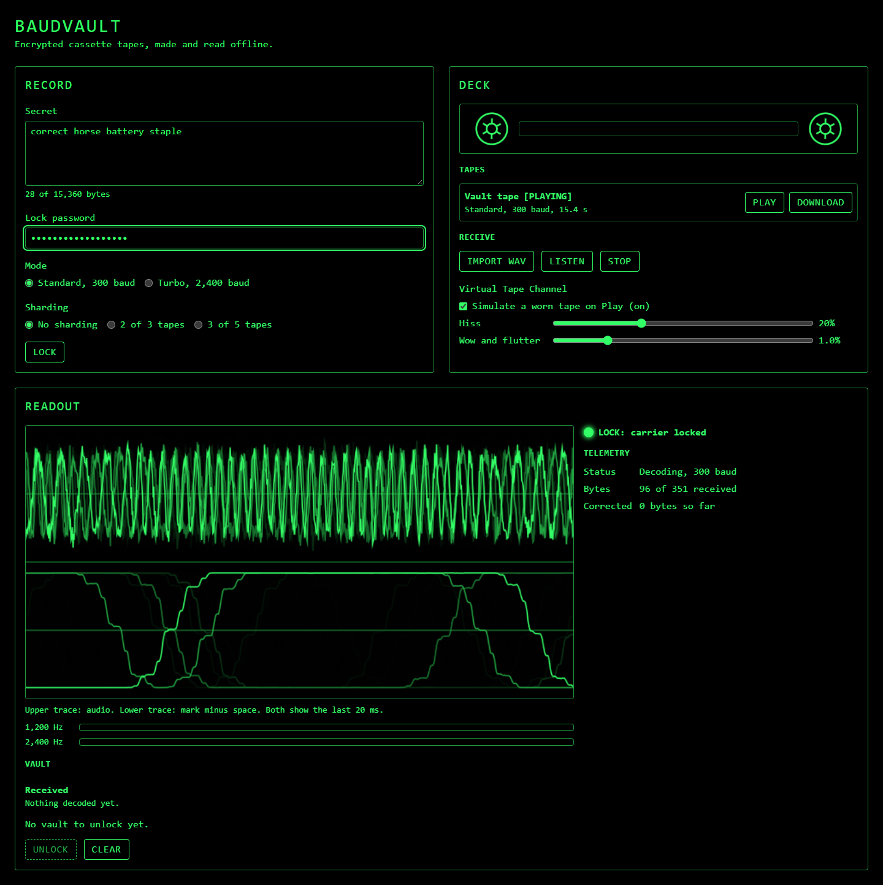
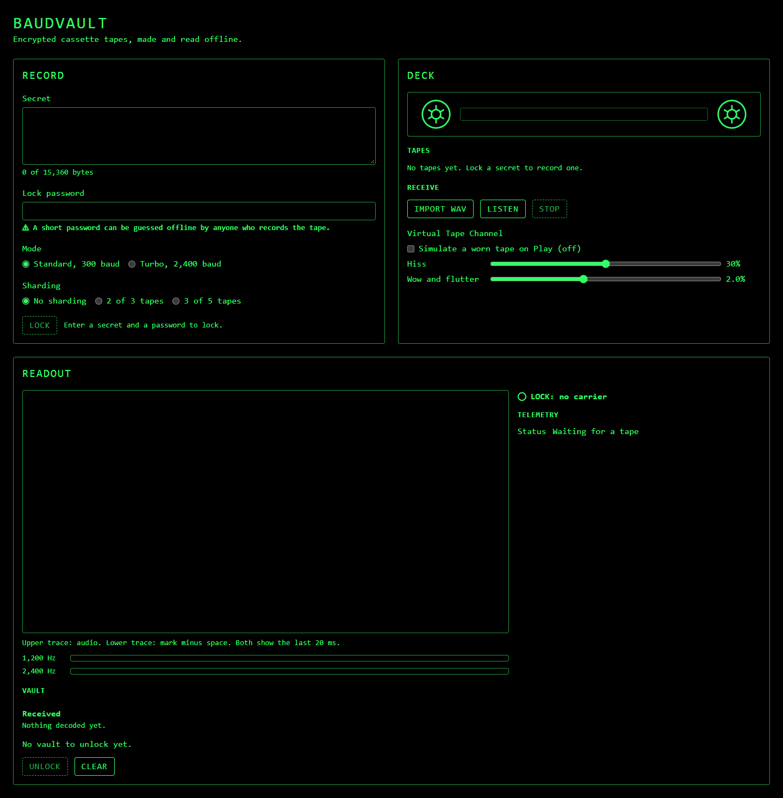
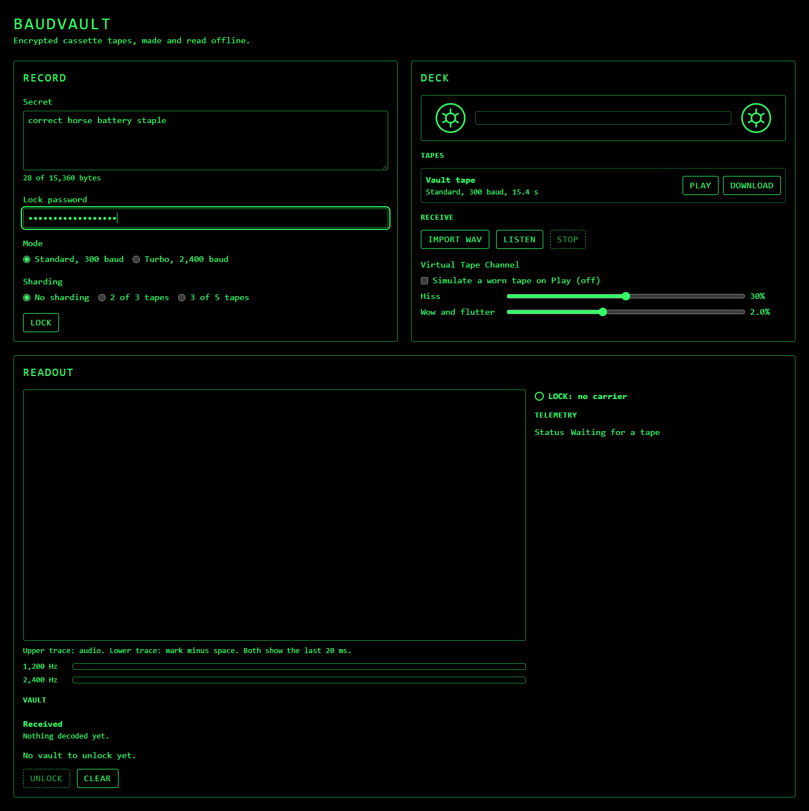
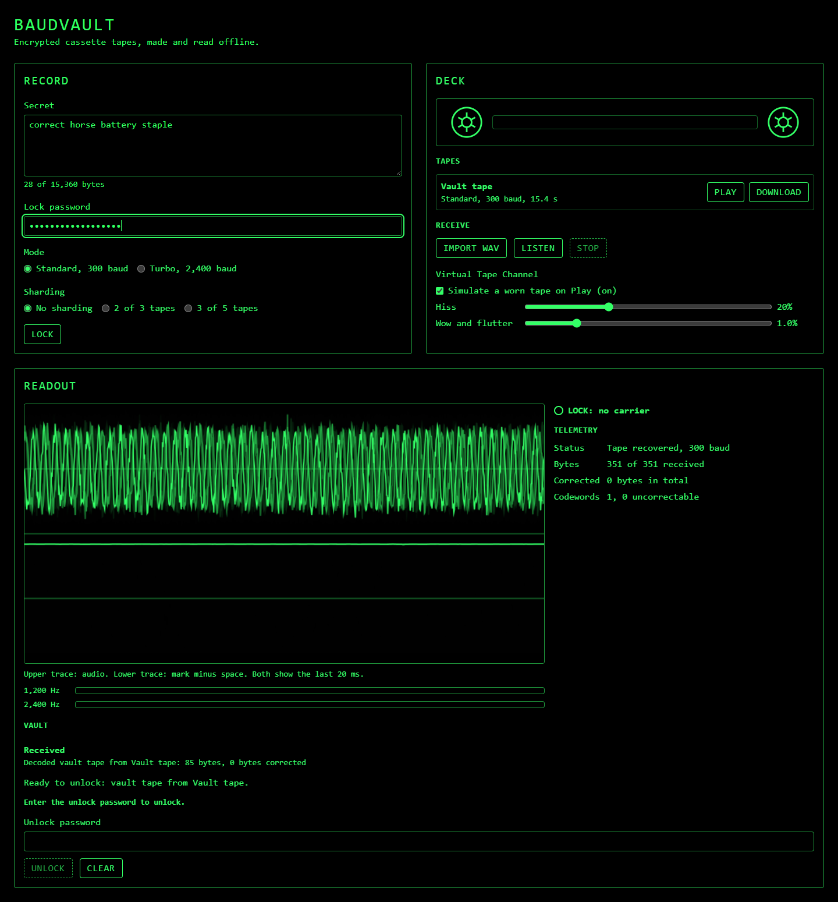
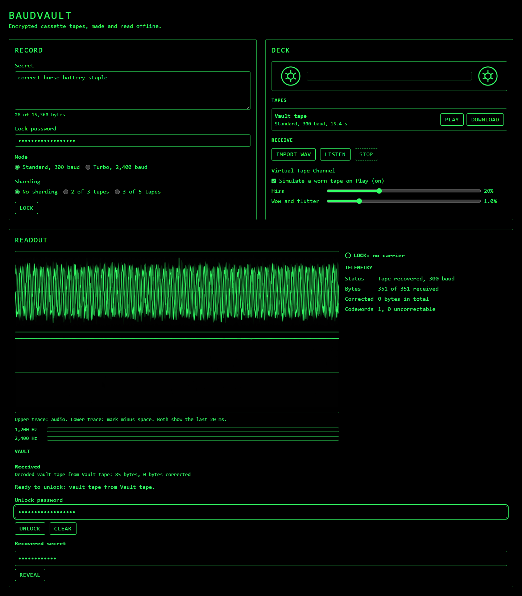

# BaudVault

BaudVault is an offline browser app that encrypts a secret, such as a password or a seed phrase, and turns it into cassette-style audio in the 1975 Kansas City Standard (KCS) format. You can save the audio as a WAV file or play it through a speaker and record it with another device's microphone. The secret never leaves the device except as sound. Reed-Solomon error correction repairs damaged bytes, and optional Shamir Secret Sharing splits the encrypted secret across several tapes.



## Contents

1. [How it works](#how-it-works)
2. [Using the app](#using-the-app)
3. [Security model and air gap](#security-model-and-air-gap)
4. [Tech stack](#tech-stack)
5. [Project structure](#project-structure)
6. [Getting started](#getting-started)
7. [Testing](#testing)
8. [Deployment](#deployment)
9. [Browser support](#browser-support)
10. [Manual checks still to do](#manual-checks-still-to-do)
11. [License](#license)

## How it works

### Lock path

1. The secret is encoded as UTF-8 (1 to 15,360 bytes) and compressed with Deflate.
2. The Lock password is normalized to Unicode NFC. PBKDF2-HMAC-SHA-256 with 600,000 iterations and a random 16-byte salt derives a 256-bit key. AES-256-GCM with a random 12-byte IV encrypts the compressed bytes. The result is the Envelope (version byte, iteration count, salt, IV, ciphertext, 16-byte tag).
3. Optionally, Shamir Secret Sharing over GF(256) splits the Envelope into Shards. The UI offers 2-of-3 and 3-of-5. The engine accepts any 2 ≤ K ≤ N ≤ 16.
4. The Tape_Framer turns each Body (the Envelope or one Shard) into a Tape_Record: two copies of a 48-byte Header_Frame, then Reed-Solomon (255, 223) Codewords (223 data bytes and 32 parity bytes each, so up to 16 wrong bytes per Codeword are repaired). A CRC-32 of the Body is stored in the header. Standard mode uses an interleave depth of 1. Turbo mode interleaves 4 Codewords so a burst of up to 64 bytes is spread across 4 blocks.
5. The Modulator sends each byte as an 11-bit frame (start bit 0, eight data bits LSB first, two stop bits 1) using frequency-shift keying: 1,200 Hz for a 0 bit and 2,400 Hz for a 1 bit. Standard mode runs at 300 baud and Turbo mode at 2,400 baud. A 2.0 s leader and a 0.5 s trailer of 2,400 Hz tone surround the record. Output is mono, 44,100 Hz, with sine tones at 0.7 of full scale.
6. The tape is played through the speaker or downloaded as a 16-bit PCM WAV file.

### Unlock path

1. Audio comes from a WAV import or from the microphone.
2. The bit demodulator compares sliding Goertzel energy at 1,200 Hz and 2,400 Hz over a window of one bit period.
3. The Tape_Decoder looks for the leader tone and locks onto the carrier. It tries both 300 and 2,400 baud on the header, reads the Header_Frame (the second copy is the fallback), and decodes the Codewords. It emits exactly one byte per frame period even when it finds no start bit, because Reed-Solomon repairs wrong bytes but not missing or extra ones.
4. Reed-Solomon repairs damaged bytes. The CRC-32 check catches rare miscorrections.
5. For sharded tapes, the app collects Shards until K distinct ones from one set are decoded, then rebuilds the Envelope.
6. When an Envelope is held, the Vault section shows an Unlock password field. Opening the Envelope with the right password returns the secret.

```mermaid
flowchart LR
  subgraph Lock
    A[Secret, UTF-8] --> B[Deflate]
    B --> C["PBKDF2-HMAC-SHA-256 + AES-256-GCM<br/>Envelope"]
    C --> D{Sharding?}
    D -- no --> E[Body]
    D -- "2-of-3 or 3-of-5" --> F[Shamir Shards] --> E
    E --> G["Tape_Framer<br/>Reed-Solomon + CRC"]
    G --> H["KCS FSK modulator<br/>300 or 2,400 baud"]
    H --> I[Speaker or WAV download]
  end
  subgraph Unlock
    J[Microphone or WAV import] --> K[Goertzel demodulator]
    K --> L["Tape_Decoder<br/>Reed-Solomon + CRC"]
    L --> M{Shards?}
    M -- yes --> N[Combine K Shards] --> O[Envelope]
    M -- no --> O
    O --> P["Open with Unlock password"]
    P --> Q[Secret]
  end
  I -. sound .-> J
```



### Virtual Tape Channel

The Virtual Tape Channel simulates playback from a worn cassette so you can watch error correction work without a deck. It applies a 300 Hz to 5,000 Hz bandpass filter, a time-varying playback speed (wow and flutter), and white noise (hiss). The hiss slider goes from 0% to 60% of the nominal carrier level. The wow slider goes from 0% to 5% peak speed deviation. A seeded random generator makes the damage reproducible. The channel is applied only when you press Play. Download and WAV import never use it. The design requires full recovery up to 30% hiss and 2% wow in both modes.

### Oscilloscope and telemetry

The Readout panel draws a two-trace oscilloscope on a canvas. The upper trace is the audio of the last 20 ms (the Virtual Tape Channel output when the channel is on). The lower trace is the decoder's mark-minus-space energy. Two bars show the current 1,200 Hz and 2,400 Hz Goertzel energy. A LOCK indicator, bytes received against bytes expected, corrected bytes, and Codeword counts are also shown as text.

## Using the app

BaudVault is a single screen with three panels.



### Record panel

- **Secret**: the text to protect. The panel shows the size against the 15,360-byte limit.
- **Lock password**: a masked field used only by Lock. A warning appears while it has fewer than 12 Unicode code points: "A short password can be guessed offline by anyone who records the tape." Lock stays enabled.
- **Mode**: Standard (300 baud) or Turbo (2,400 baud).
- **Sharding**: no sharding, 2 of 3 tapes, or 3 of 5 tapes.
- **Lock**: seals the secret and lists one tape per Body. A busy indicator shows while the key is derived, and Lock and Unlock are disabled during that time.

### Deck panel

- **Tapes**: each tape shows its label, mode, duration, and for Shards how many unlock the vault. Each has **Play** and **Download** (WAV).
- **Import WAV**: decodes one or more WAV files.
- **Listen**: captures the microphone and decodes live. **Stop** stops playback or listening and releases the microphone.
- **Virtual Tape Channel**: a switch plus **Hiss** and **Wow and flutter** sliders.
- The cassette reels turn while audio plays or the microphone listens, unless the operating system asks for reduced motion.

### Readout panel

- The oscilloscope, the 1,200 Hz and 2,400 Hz bars, the LOCK indicator, and the telemetry list.
- The **Vault** section lists decoded tapes, Shard progress, and whether a vault is ready. The **Unlock password** field appears only once a decoded Envelope (or one rebuilt from K Shards) is held. **Unlock** opens it. The recovered secret stays masked until you select **Reveal** (and **Hide** masks it again). **Clear** removes the secret, both passwords, the tapes, and the held Envelope from the app state and zeroes the Plaintext byte arrays.
- A wrong password shows "Wrong password or damaged tape", empties the Unlock password field, and keeps the Envelope for another try.

### Walkthrough

1. Type a secret and a Lock password in the Record panel. The screenshots use the demo secret `correct horse battery staple`. Choose a mode and a sharding option, then select **Lock**.

   

2. Select **Play** on the tape. Optionally switch on the Virtual Tape Channel first. The oscilloscope and telemetry become active, the LOCK indicator lights, and the byte count rises.

   

   Instead of playing, you can **Download** the tape as a WAV file and **Import WAV** it later, on this device or another one. You can also play the tape near a second device and use **Listen** there.

3. When the tape is decoded, the Vault section reports that the vault is ready and shows the Unlock password field.

   

4. Type the password in the Unlock password field and select **Unlock**. The recovered secret is shown masked. Select **Reveal** to read it, and **Clear** when you are done.

   

With sharded tapes, play or import tapes one by one. The Vault section shows how many distinct Shards of the set are decoded against K, and the Unlock password field appears once K Shards are in.

## Security model and air gap

The main promise is that the secret leaves the device only as sound. These measures back it up.

- **No network APIs in `src/`.** No file under `src/` may contain `fetch`, `XMLHttpRequest`, `WebSocket`, `EventSource`, `sendBeacon`, or `RTCPeerConnection`. This covers comments, strings, test files, and longer identifiers.
- **Source scan.** `npm run airgap` (`scripts/airgap-scan.mjs`) searches `src/` for those words and prints `file:line` for each match. `npm test` runs it first.
- **Build scan.** `npm run airgap:dist` scans every `.js` file in `dist/` except the service worker for calls and uses of those APIs. `npm run build` runs it after the Vite build. A text scan cannot catch obfuscated access, so the CSP below is the runtime backstop.
- **Kiro hooks** (`.kiro/hooks/`). *Air-Gap Guard* is a `PreToolUse` hook that runs `scripts/airgap-hook.mjs` and blocks an agent write that puts a forbidden word into `src/`. *Air-Gap Save Check* is a `PostFileSave` agent hook that runs `npm run airgap` when you save a file under `src/`.
- **Content-Security-Policy.** The HTML paths are served with `default-src 'self'; connect-src 'none'; img-src 'self' blob: data:; media-src 'self' blob:; object-src 'none'; base-uri 'none'; frame-ancestors 'none'`.
- **Same-origin assets.** Every script, stylesheet, font, and image comes from the app's own origin. Vite's modulepreload polyfill, which contains a network call, is disabled.
- **Offline service worker.** The build generates `dist/sw.js`. It precaches same-origin build output and serves only those URLs, so the app loads after a reload while offline.
- **Randomness.** Salts, IVs, Shard set IDs, and Shamir coefficients come only from `crypto.getRandomValues`. The seeded generator in `src/channel/prng.ts` serves only the Virtual Tape Channel.
- **Nothing sensitive is written out.** The Plaintext, both passwords, derived keys, and decrypted bytes are never written to the console, `localStorage`, `sessionStorage`, IndexedDB, cookies, or the URL. Error classes take a fixed message and safe numbers only. Live-region announcements never contain the secret or a password.
- **Clear.** Clear drops the secret and both passwords from state, removes tapes and Envelopes, and overwrites Plaintext byte arrays with zeros.
- **Short passwords.** The Record panel warns when the Lock password has fewer than 12 code points.
- **Other details.** The secret field turns off spell checking and autocomplete, because some browsers send spell-check text to a remote service. The microphone is requested with echo cancellation, noise suppression, and automatic gain control turned off.

### What it does not protect against

- Anyone who records the audio can attack the password offline. PBKDF2 with 600,000 iterations is the main defense, so a weak password can still be guessed.
- JavaScript strings cannot be wiped. Clear can only drop the secret, Lock password, and Unlock password strings. Byte arrays are zeroed, but copies of the strings may stay in memory until the browser collects them.
- The secret field is plain text, so anyone who can see the screen can read it.
- A text scan cannot detect obfuscated network access. The CSP `connect-src 'none'` is the backstop for that case, and it applies only where the headers are served (the Netlify deployment).
- Shamir sharding runs on the ciphertext. One Shard reveals nothing about the Envelope, and K Shards still require the password.

## Tech stack

Versions are the ranges in `package.json`.

| Part | Version or API |
|---|---|
| React, React DOM | ^19.3.1 |
| TypeScript | ~7.0.2 |
| Vite | ^8.3.6 (with `@vitejs/plugin-react` ^6.1.2) |
| Tailwind CSS | ^4.3.5 (with `@tailwindcss/vite` ^4.3.5) |
| Vitest | ^5.1.0 |
| fast-check | ^4.10.2 |
| oxlint | ^1.90.0 |
| Web Audio and AudioWorklet | browser API (playback, microphone capture) |
| Web Crypto | browser API (PBKDF2, AES-256-GCM, `getRandomValues`) |
| CompressionStream and DecompressionStream | browser API (Deflate) |
| Netlify | hosting, headers from `public/_headers` |

The only runtime dependencies are `react` and `react-dom`.

## Project structure

```
src/
  App.tsx, main.tsx, index.css   single-screen app, entry point, styles
  core/        errors.ts (error classes), bytes.ts (big-endian helpers, concat, zeroize)
  crypto/      vault.ts (seal and open), compress.ts (Deflate with output cap)
  gf256/       gf256.ts (GF(256) tables and arithmetic, shared by Shamir and Reed-Solomon)
  shamir/      shamir.ts (split, combine, Shard encode and parse)
  fec/         reed-solomon.ts (255, 223 codec), crc.ts (CRC-32, CRC-16/CCITT-FALSE)
  tape/        framer.ts (Header_Frame, interleaving, frame and unframe), tape-decoder.ts (streaming decoder)
  modem/       kcs-modulator.ts, goertzel.ts, bit-demodulator.ts, wav.ts, biquad.ts (shared with channel)
  channel/     virtual-tape.ts (Virtual Tape Channel), prng.ts (seeded generator, simulation only)
  audio/       playback.ts, microphone.ts, mic-worklet.ts (AudioWorklet processor)
  ui/          React panels and DOM-free rules
    RecordPanel.tsx, DeckPanel.tsx, ReadoutPanel.tsx, UnlockSection.tsx, FeatureNotice.tsx
    use-tape-deck.ts     audio sources and their decoders
    tapes.ts             Lock pipeline and tape descriptors
    receiver.ts, shard-collection.ts, telemetry.ts   decoder events into UI state
    record-rules.ts, unlock.ts, passwords.ts, channel-controls.ts, features.ts, messages.ts, announcements.ts
    scope.ts, contrast.ts   oscilloscope geometry, palette contrast checks
  properties/  p1 to p5 fast-check property suites
scripts/       airgap-scan.mjs, airgap-hook.mjs, airgap-words.mjs, sw-plugin.ts
test/          no-network.setup.ts, airgap-scan.test.ts, airgap-hook.test.ts, headers.test.ts,
               no-network.test.ts, palette-contrast.test.ts, sw-plugin.test.ts
public/        _headers (Netlify CSP headers), favicon.svg
docs/          screenshots used by this README
.kiro/         specs, steering, hooks, and the dsp-auditor agent
netlify.toml   build command and publish directory
```

Unit tests sit next to their module as `*.test.ts`.

**Import layering rule** (from `design.md`): imports flow downward only, `ui → audio → tape → (modem, fec) → gf256 → core`. Nothing in the pure core imports from `audio` or `ui`. `channel` sits beside `tape` and may import `modem`. `modem` never imports `channel`, which is why the biquad lives in `modem/`. Only `src/audio` and `src/ui` touch browser APIs other than Web Crypto and the compression streams, so every other stage runs in Node tests.

## Getting started

Prerequisite: Node.js. No version is stated in the repository. The project was verified with Node 24 (v24.22.0), and the design notes refer to Node 24.

```
npm install
npm run dev
```

Vite prints the local address. Microphone capture needs a secure context (HTTPS or `localhost`). The service worker is generated only by `npm run build`, so offline mode is not available under `npm run dev`.

| Script | What it does |
|---|---|
| `npm run dev` | Starts the Vite dev server. |
| `npm run build` | Runs `tsc -b`, `vite build` (which also writes `dist/sw.js`), then `npm run airgap:dist`. |
| `npm run preview` | Serves the built `dist/` with Vite. |
| `npm run airgap` | Scans `src/` for the forbidden network words. |
| `npm run airgap:dist` | Scans the emitted JavaScript in `dist/` (except the service worker). |
| `npm run lint` | Runs oxlint. |
| `npm run typecheck` | Runs `tsc -b`. |
| `npm test` | Runs the source air-gap scan, then `vitest run`. |
| `npm run test:watch` | Runs Vitest in watch mode. |

## Testing

`npm test` runs the source scan and then Vitest. The design budget for the full run is under 15 seconds.

- **Unit tests** sit next to each module and in `test/`. They cover the GF(256) tables, CRC check values, Reed-Solomon limits (16 errors repaired, 17 rejected), modulator length, WAV parsing, Envelope and Shard validation, the decoder's header and carrier handling, channel determinism, the scanner, the hook script, the headers, and the service worker plugin.
- **Property tests** (fast-check, 200 runs each, in `src/properties/`):
  1. **P1 Seal and open round trip.** Any Plaintext of 1 to 15,360 bytes and any non-empty password without U+0000 opens to the original, also with the NFD form of the password.
  2. **P2 Authentication rejects every change.** A different password throws `AuthenticationError`. Any single bit flip throws `FormatError` (version byte, or an iteration count outside 1,000 to 5,000,000) or `AuthenticationError`. Plaintext is never returned.
  3. **P3 Shamir threshold reconstruction.** Any K or more of N Shards in any order rebuild the Envelope. K − 1 Shards throw `ShardError`.
  4. **P4 Reed-Solomon repairs bounded damage.** Up to 16 changed bytes per Codeword and in the first header copy, or one burst of up to 16 × D bytes, are repaired in either mode, with the corrected-byte count matching.
  5. **P5 Acoustic round trip.** A Body of 1 to 32 bytes demodulates back with zero corrected bytes at both baud rates, and survives the Virtual Tape Channel at up to 30% hiss and 2% wow with any seed, in both modes.
- **No-network setup.** `test/no-network.setup.ts` replaces the browser network globals and the Node request, socket, and DNS entry points with stubs that throw. Any test that reaches for the network fails.
- **Bench project.** `vite.config.ts` defines two Vitest projects. `unit` runs everything except `*.bench.test.ts`. `bench` runs the speed tests (`src/modem/bit-demodulator.bench.test.ts`) one file at a time after `unit` finishes, because they measure wall time.
- **Turbo measurement (opt-in).** The full Turbo-mode measurement in `src/channel/turbo-measurement.test.ts` is too slow for `npm test`. Run it with `BAUDVAULT_TURBO_MEASUREMENT=1`, for example in PowerShell: `$env:BAUDVAULT_TURBO_MEASUREMENT = '1'; npx vitest run src/channel/turbo-measurement.test.ts`. `BAUDVAULT_TURBO_SEED` picks another master seed. A small always-on regression with the same pass criterion runs in every `npm test`.

## Deployment

The site is built for Netlify. `netlify.toml` sets the build command `npm run build` and the publish directory `dist`.

- `public/_headers` is copied into `dist/` by Vite. It sets the CSP shown above on the paths `/` and `/index.html`.
- `/sw.js` gets `Content-Security-Policy: default-src 'self'` and `Cache-Control: no-cache`.
- There is no `/*` CSP rule on purpose. Netlify merges headers from every matching rule, and a browser enforces every CSP header it receives, so a second policy on the service worker would block precaching.
- The `scripts/sw-plugin.ts` Vite plugin writes `dist/sw.js` after the bundle is built. It precaches every emitted build file and every file from `public/` (except `sw.js` and `_headers`) as relative same-origin paths, and names the cache from a hash of their contents so a new build replaces the old cache. `src/main.tsx` registers `/sw.js` in production builds only.

## Browser support

Requirement 10.1 targets the two most recent stable major versions, at the time of testing, of desktop Chrome, Edge, Firefox, and Safari, Chrome on Android, and Safari on iOS. This matrix has not been tested (see the next section). The README screenshots were taken with desktop Google Chrome.

The app checks for features at startup and says what is missing:

- Without `crypto.subtle`, `CompressionStream`, or `DecompressionStream`, it names each missing feature and disables Lock and Unlock. WAV import and the Virtual Tape Channel stay available.
- Without `AudioWorkletNode` or `navigator.mediaDevices.getUserMedia`, or outside a secure context, it disables Listen and states each reason. WAV import and the Virtual Tape Channel stay available.
- If the browser denies microphone access, the Deck shows "Microphone access was denied" and WAV import stays available.

## Manual checks still to do

These are listed in `.kiro/specs/baudvault-core/tasks.md` as checks the agent did not run:

- Phone-to-laptop playback in Standard mode, including a desk tap (BV-08).
- Offline reload and phone-to-laptop recovery on the deployed site, and the live response headers (BV-11).
- The browser matrix in Requirement 10.1.
- A quick browser check that the Unlock password field is hidden at start, appears after importing a WAV, and is emptied by Clear.

The Tape Librarian companion app (BV-10) and the demo package (BV-12) are tracked outside this repository.

## License

MIT License, Copyright (c) 2026 Christian_t. See [LICENSE](LICENSE).
